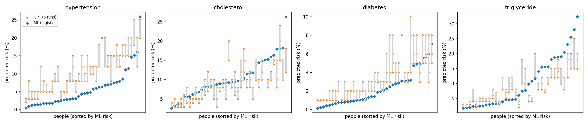

# 위험 예측 방식 비교 (2026-10-13)

설계: `docs/superpowers/specs/2026-10-13-model-comparison-design.md`. 19–59세 학습, 25–44세 바깥 5-fold 예측. 모든 모델이 같은 사람을 평가한다.

④를 넣은 비교는 사용량 한도 때문에 25–44세에서 무작위로 뽑은 500명만 쓴다. 질환별 n이 이보다 작은 것은 그 질환의 라벨(예: 중성지방은 12시간 공복)이 없는 사람과 GPT 1회차 실패자를 뺐기 때문이다. ⓪–③의 전원(약 2,900명) 결과는 `compare-2026-10-13.md`(1단계 보고서)에 있다.

## 요약 (AUROC, 95% CI)

| 질환 | n / 양성 | ⓪ 나이+성별 | ① 체크리스트 | ② 배포 로지스틱 | ③ XGBoost | ④ GPT |
|---|---|---|---|---|---|---|
| 고혈압 | 500 / 33 | 0.738 (0.650–0.821) | 0.782 (0.686–0.867) | 0.816 (0.736–0.883) | 0.797 (0.712–0.867) | 0.791 (0.702–0.868) |
| 고콜레스테롤 | 485 / 55 | 0.632 (0.553–0.707) | 0.708 (0.638–0.779) | 0.702 (0.634–0.765) | 0.689 (0.611–0.758) | 0.717 (0.649–0.783) |
| 당뇨 | 482 / 16 | 0.610 (0.460–0.759) | 0.771 (0.636–0.867) | 0.759 (0.614–0.872) | 0.753 (0.587–0.887) | 0.803 (0.665–0.907) |
| 고중성지방 | 427 / 58 | 0.755 (0.685–0.824) | 0.697 (0.629–0.763) | 0.791 (0.723–0.850) | 0.794 (0.735–0.851) | 0.752 (0.689–0.811) |

## 고혈압 (`hypertension`)

실제 유병률 6.6%. 민감도는 ②의 '보통 이상' 판정 특이도(73.0%) 이상이 되는 가장 낮은 기준값의 값이다. 정수 점수(①, ④)는 동점 때문에 실제 특이도가 목표보다 높을 수 있어 함께 적는다.

| 모델 | AUROC | ② 대비 AUROC 차이 | AUPRC | Brier | 평균 예측 | 민감도 / 실제 특이도 |
|---|---|---|---|---|---|---|
| ⓪ 나이+성별 | 0.738 (0.650–0.821) | -0.077 (-0.143–-0.009) | 0.164 (0.097–0.278) | 0.0590 (0.0431–0.0769) | 9.0% | 57.6% (40.8%–72.8%) / 특이도 73.2% |
| ① 체크리스트 | 0.782 (0.686–0.867) | -0.033 (-0.087–0.025) | 0.226 (0.132–0.344) | 해당 없음 | 해당 없음 | 72.7% (55.8%–84.9%) / 특이도 73.0% |
| ② 배포 로지스틱 | 0.816 (0.736–0.883) | 기준 | 0.269 (0.162–0.441) | 0.0557 (0.0421–0.0712) | 9.0% | 72.7% (55.8%–84.9%) / 특이도 73.0% |
| ③ XGBoost | 0.797 (0.712–0.867) | -0.018 (-0.049–0.010) | 0.239 (0.143–0.410) | 0.0579 (0.0437–0.0751) | 8.6% | 72.7% (55.8%–84.9%) / 특이도 73.0% |
| ④ GPT | 0.791 (0.702–0.868) | -0.024 (-0.052–0.004) | 0.238 (0.129–0.382) | 0.0601 (0.0468–0.0746) | 12.8% | 69.7% (52.7%–82.6%) / 특이도 77.7% |

| 하위군 | n / 양성 | ⓪ 나이+성별 | ① 체크리스트 | ② 배포 로지스틱 | ③ XGBoost | ④ GPT |
|---|---|---|---|---|---|---|
| 25-34 | 205 / 3 | 표본 부족 | 표본 부족 | 표본 부족 | 표본 부족 | 표본 부족 |
| 35-44 | 295 / 30 | 0.640 (0.528–0.752) | 0.756 (0.654–0.853) | 0.781 (0.685–0.869) | 0.752 (0.653–0.844) | 0.759 (0.654–0.849) |

## 고콜레스테롤 (`cholesterol`)

실제 유병률 11.3%. 민감도는 ②의 '보통 이상' 판정 특이도(66.3%) 이상이 되는 가장 낮은 기준값의 값이다. 정수 점수(①, ④)는 동점 때문에 실제 특이도가 목표보다 높을 수 있어 함께 적는다.

| 모델 | AUROC | ② 대비 AUROC 차이 | AUPRC | Brier | 평균 예측 | 민감도 / 실제 특이도 |
|---|---|---|---|---|---|---|
| ⓪ 나이+성별 | 0.632 (0.553–0.707) | -0.070 (-0.129–-0.008) | 0.205 (0.137–0.313) | 0.0987 (0.0798–0.1200) | 12.6% | 58.2% (45.0%–70.3%) / 특이도 66.3% |
| ① 체크리스트 | 0.708 (0.638–0.779) | 0.006 (-0.034–0.046) | 0.203 (0.145–0.285) | 해당 없음 | 해당 없음 | 45.5% (33.0%–58.5%) / 특이도 83.5% |
| ② 배포 로지스틱 | 0.702 (0.634–0.765) | 기준 | 0.226 (0.149–0.336) | 0.0960 (0.0772–0.1163) | 12.4% | 63.6% (50.4%–75.1%) / 특이도 66.3% |
| ③ XGBoost | 0.689 (0.611–0.758) | -0.013 (-0.048–0.021) | 0.245 (0.165–0.370) | 0.0955 (0.0774–0.1164) | 12.3% | 58.2% (45.0%–70.3%) / 특이도 66.3% |
| ④ GPT | 0.717 (0.649–0.783) | 0.015 (-0.022–0.052) | 0.227 (0.162–0.338) | 0.0948 (0.0751–0.1173) | 9.9% | 60.0% (46.8%–71.9%) / 특이도 69.1% |

| 하위군 | n / 양성 | ⓪ 나이+성별 | ① 체크리스트 | ② 배포 로지스틱 | ③ XGBoost | ④ GPT |
|---|---|---|---|---|---|---|
| 25-34 | 195 / 14 | 0.553 (0.380–0.700) | 0.731 (0.602–0.839) | 0.715 (0.578–0.834) | 0.687 (0.530–0.829) | 0.688 (0.571–0.796) |
| 35-44 | 290 / 41 | 0.600 (0.503–0.701) | 0.676 (0.581–0.758) | 0.665 (0.577–0.751) | 0.664 (0.571–0.759) | 0.709 (0.622–0.786) |

## 당뇨 (`diabetes`)

실제 유병률 3.3%. 민감도는 ②의 '보통 이상' 판정 특이도(80.7%) 이상이 되는 가장 낮은 기준값의 값이다. 정수 점수(①, ④)는 동점 때문에 실제 특이도가 목표보다 높을 수 있어 함께 적는다.

| 모델 | AUROC | ② 대비 AUROC 차이 | AUPRC | Brier | 평균 예측 | 민감도 / 실제 특이도 |
|---|---|---|---|---|---|---|
| ⓪ 나이+성별 | 0.610 (0.460–0.759) | -0.149 (-0.270–-0.024) | 0.067 (0.030–0.177) | 0.0318 (0.0189–0.0468) | 3.7% | 43.8% (23.1%–66.8%) / 특이도 80.7% |
| ① 체크리스트 | 0.771 (0.636–0.867) | 0.011 (-0.033–0.059) | 0.093 (0.045–0.156) | 해당 없음 | 해당 없음 | 6.2% (1.1%–28.3%) / 특이도 94.2% |
| ② 배포 로지스틱 | 0.759 (0.614–0.872) | 기준 | 0.113 (0.052–0.255) | 0.0315 (0.0192–0.0455) | 3.5% | 50.0% (28.0%–72.0%) / 특이도 80.7% |
| ③ XGBoost | 0.753 (0.587–0.887) | -0.006 (-0.085–0.058) | 0.112 (0.053–0.238) | 0.0316 (0.0196–0.0452) | 3.3% | 75.0% (50.5%–89.8%) / 특이도 80.7% |
| ④ GPT | 0.803 (0.665–0.907) | 0.044 (0.000–0.106) | 0.125 (0.057–0.237) | 0.0306 (0.0189–0.0441) | 4.3% | 75.0% (50.5%–89.8%) / 특이도 80.9% |

| 하위군 | n / 양성 | ⓪ 나이+성별 | ① 체크리스트 | ② 배포 로지스틱 | ③ XGBoost | ④ GPT |
|---|---|---|---|---|---|---|
| 25-34 | 192 / 3 | 표본 부족 | 표본 부족 | 표본 부족 | 표본 부족 | 표본 부족 |
| 35-44 | 290 / 13 | 0.531 (0.325–0.749) | 0.755 (0.645–0.838) | 0.734 (0.586–0.862) | 0.759 (0.595–0.890) | 0.795 (0.660–0.898) |

## 고중성지방 (`triglyceride`)

실제 유병률 13.6%. 민감도는 ②의 '보통 이상' 판정 특이도(68.6%) 이상이 되는 가장 낮은 기준값의 값이다. 정수 점수(①, ④)는 동점 때문에 실제 특이도가 목표보다 높을 수 있어 함께 적는다.

| 모델 | AUROC | ② 대비 AUROC 차이 | AUPRC | Brier | 평균 예측 | 민감도 / 실제 특이도 |
|---|---|---|---|---|---|---|
| ⓪ 나이+성별 | 0.755 (0.685–0.824) | -0.035 (-0.083–0.009) | 0.367 (0.271–0.501) | 0.1082 (0.0854–0.1329) | 10.6% | 70.7% (58.0%–80.8%) / 특이도 69.4% |
| ① 체크리스트 | 0.697 (0.629–0.763) | -0.094 (-0.162–-0.029) | 0.235 (0.169–0.329) | 해당 없음 | 해당 없음 | 43.1% (31.2%–55.9%) / 특이도 83.5% |
| ② 배포 로지스틱 | 0.791 (0.723–0.850) | 기준 | 0.355 (0.258–0.478) | 0.1030 (0.0816–0.1270) | 10.7% | 79.3% (67.2%–87.7%) / 특이도 68.6% |
| ③ XGBoost | 0.794 (0.735–0.851) | 0.003 (-0.023–0.029) | 0.356 (0.268–0.495) | 0.1009 (0.0810–0.1235) | 12.0% | 77.6% (65.3%–86.4%) / 특이도 68.6% |
| ④ GPT | 0.752 (0.689–0.811) | -0.039 (-0.081–0.003) | 0.292 (0.212–0.398) | 0.1095 (0.0864–0.1348) | 9.6% | 62.1% (49.2%–73.4%) / 특이도 71.3% |

| 하위군 | n / 양성 | ⓪ 나이+성별 | ① 체크리스트 | ② 배포 로지스틱 | ③ XGBoost | ④ GPT |
|---|---|---|---|---|---|---|
| 25-34 | 172 / 16 | 0.660 (0.532–0.791) | 0.754 (0.643–0.855) | 0.748 (0.618–0.861) | 0.776 (0.653–0.888) | 0.786 (0.656–0.886) |
| 35-44 | 255 / 42 | 0.790 (0.709–0.857) | 0.654 (0.562–0.752) | 0.802 (0.725–0.866) | 0.790 (0.718–0.855) | 0.716 (0.628–0.795) |

## GPT 반복 응답 편차 (같은 입력 5회)

모델 `gpt-5.6-luna`(Codex CLI). 무작위 40명에게 같은 입력을 5회 넣었다. 판정 변경은 위 '같은 특이도' 기준값으로 5회 응답을 판정했을 때 양성·음성이 섞인 사람의 비율이다. ML(②)은 결정적이라 모두 0이다.

| 질환 | 인원 | 표준편차 중앙값 / 90% (%p) | 범위 중앙값 / 최대 (%p) | 판정 변경 |
|---|---|---|---|---|
| 고혈압 | 40 | 1.6 / 2.9 | 3.0 / 8.0 | 20.0% |
| 고콜레스테롤 | 40 | 1.3 / 2.8 | 3.0 / 9.0 | 25.0% |
| 당뇨 | 40 | 0.5 / 1.6 | 1.0 / 6.0 | 22.5% |
| 고중성지방 | 40 | 1.3 / 2.7 | 3.0 / 10.0 | 22.5% |



## 한계

- GPT 응답 기록 660건(사람·반복별 최종 기록) 중 실패 0건. 1회차가 실패한 사람(고혈압 0명, 고콜레스테롤 0명, 당뇨 0명, 고중성지방 0명)은 모든 모델의 비교에서 뺐다.
- Codex 에이전트 지시문은 짧은 지시문으로 바꿨지만 도구 정의 등은 여전히 붙는다. 일반 ChatGPT 대화와 조건이 완전히 같지는 않다.
- 프롬프트는 아래 1개로 고정했다. 이 실험은 LLM의 상한이 아니라, 같은 정보로 일반적인 질문을 했을 때를 측정한다.
- KNHANES 참가자의 입력 7개(ID·연도·라벨 제외)를 외부 LLM으로 보냈다. 이용약관 판단은 사용자가 했다(2026-10-13).
- 단면 자료라서 '현재 유병일 확률'을 비교한 것이다.

## 프롬프트 원문 (예시 입력)

```
당신은 의료 위험도를 추정하는 도우미입니다.
아래 사람의 정보만으로, 이 사람이 현재 각 질환에 해당할 확률을 0-100 정수로 답하세요.
정보가 제한적이어도 반드시 최선의 추정치를 숫자로 답하세요.

[정보]
나이 34세, 남성, BMI 26.1, 체지방률 27.4%
고혈압 가족력 있음, 당뇨 가족력 없음, 고지혈증 가족력 없음

[질환 정의]
- hypertension(고혈압): 측정 혈압 140/90mmHg 이상 또는 혈압약 복용
- diabetes(당뇨): 공복혈당 126mg/dL 이상, 당화혈색소 6.5% 이상, 의사 진단, 또는 약·인슐린 치료
- cholesterol(고콜레스테롤): 총콜레스테롤 240mg/dL 이상 또는 약 복용
- triglyceride(고중성지방): 12시간 이상 공복 시 중성지방 200mg/dL 이상
```
