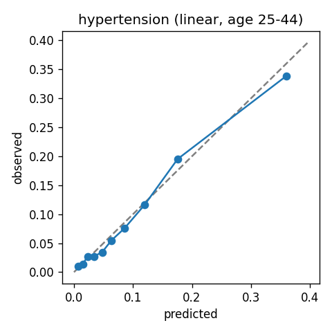
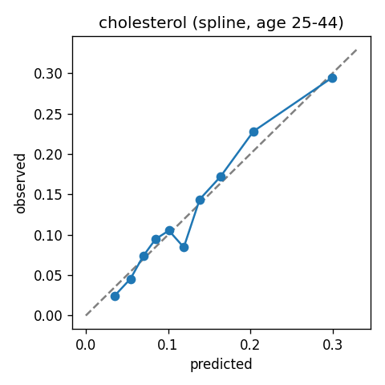
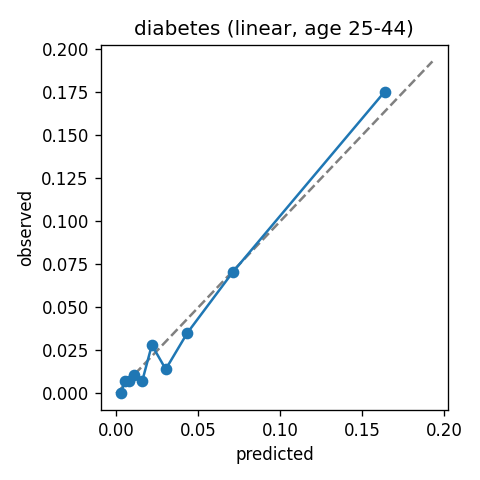
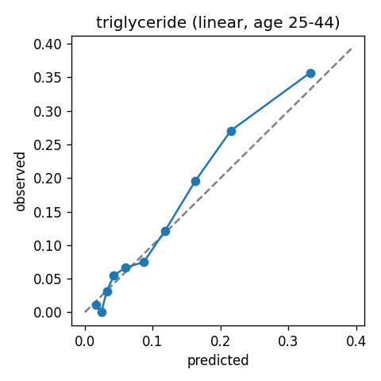

# 위험 예측 모델 평가 (2026-10-12)

설계: `docs/superpowers/specs/2026-10-12-risk-model-redesign-design.md` 5절. 주 평가는 19–59세 학습, 25–44세 중첩 교차검증이다.

## 요약

| 질환 | 채택 변형 | 통과 | AUROC (25–44) | 예측 평균 vs 실제 |
|---|---|---|---|---|
| 고혈압 | linear | ✅ | 0.804 (0.776–0.828) | 9.3% vs 8.9% |
| 고콜레스테롤 | spline | ✅ | 0.700 (0.673–0.728) | 12.7% vs 12.7% |
| 당뇨 | linear | ✅ | 0.832 (0.790–0.869) | 3.7% vs 3.6% |
| 고중성지방 | linear | ✅ | 0.791 (0.765–0.816) | 10.9% vs 11.8% |

## 고혈압 (`hypertension`)

### 주 평가 (25–44세)

| 변형 | n / 양성 | AUROC | Brier | 예측 평균 vs 실제 (95% CI) | 보정 기울기 / 절편 | 통과 기준 |
|---|---|---|---|---|---|---|
| linear | 2921 / 261 | 0.804 (0.776–0.828) | 0.0710 (0.0631–0.0782) | 9.3% vs 8.9% (8.0%–10.0%) | 0.98 / -0.10 | ✅ |
| spline | 2921 / 261 | 0.804 (0.776–0.828) | 0.0711 (0.0631–0.0783) | 9.0% vs 8.9% (8.0%–10.0%) | 0.96 / -0.10 | ✅ |

나이 스플라인 채택: **아니오** (규칙: Brier 감소 그리고 AUROC 비감소)

### 등급 (linear)

| 등급 | 인원 | 비율 | 실제 유병률 (95% CI) |
|---|---|---|---|
| low | 1939 | 66.4% | 3.2% (2.5%–4.1%) |
| medium | 761 | 26.1% | 15.2% (12.9%–18.0%) |
| high | 221 | 7.6% | 37.1% (31.0%–43.6%) |

보통 이상 민감도 75.9% (70.3%–80.7%), 특이도 70.5% (68.8%–72.2%), 높음 적중률 37.1%

### 하위군 (linear)

| 구간 | n / 양성 | AUROC | 예측 평균 vs 실제 | 민감도 / 특이도 |
|---|---|---|---|---|
| 25-34 | 1067 / 44 | 0.785 (0.696–0.861) | 4.5% vs 4.1% | 50.0% / 88.9% |
| 35-44 | 1854 / 217 | 0.780 (0.747–0.811) | 12.1% vs 11.7% | 81.1% / 59.1% |
| 남(25-44) | 1281 / 177 | 0.782 (0.744–0.816) | 13.6% vs 13.8% | 85.3% / 52.9% |
| 여(25-44) | 1640 / 84 | 0.777 (0.723–0.826) | 5.9% vs 5.1% | 56.0% / 83.0% |

### 비교

- 나이+성별 모델 AUROC 0.720, 차이(linear) 0.084 (0.057–0.113)
- 기존 배포 모델(새 라벨 기준, 전체 데이터로 학습돼 낙관적): AUROC 0.783 (0.756–0.808), 예측 평균 24.4% vs 실제 8.9%, 보정 기울기 1.31

| 모델 (vs 로지스틱 회귀) | AUROC 차이 | Brier 차이 | 보정 기울기 |
|---|---|---|---|
| spline | -0.000 (-0.002–0.001) | 0.0001 (-0.0001–0.0002) | 0.96 |
| rf | -0.011 (-0.022–-0.000) | 0.0006 (-0.0009–0.0020) | 1.10 |
| xgb | -0.010 (-0.020–-0.000) | 0.0007 (-0.0006–0.0021) | 0.87 |

### 시간 검증 (2022–23 학습 → 2024, 40–59세)

n 1853 / 양성 502, AUROC 0.771 (0.747–0.792), 예측 평균 25.9% vs 실제 27.1%, 보정 기울기 1.02

## 고콜레스테롤 (`cholesterol`)

### 주 평가 (25–44세)

| 변형 | n / 양성 | AUROC | Brier | 예측 평균 vs 실제 (95% CI) | 보정 기울기 / 절편 | 통과 기준 |
|---|---|---|---|---|---|---|
| linear | 2849 / 361 | 0.696 (0.668–0.723) | 0.1040 (0.0959–0.1130) | 12.9% vs 12.7% (11.5%–13.9%) | 0.97 / -0.08 | ✅ |
| spline | 2849 / 361 | 0.700 (0.673–0.728) | 0.1039 (0.0958–0.1131) | 12.7% vs 12.7% (11.5%–13.9%) | 1.07 / 0.12 | ✅ |

나이 스플라인 채택: **예** (규칙: Brier 감소 그리고 AUROC 비감소)

### 등급 (spline)

| 등급 | 인원 | 비율 | 실제 유병률 (95% CI) |
|---|---|---|---|
| low | 1764 | 61.9% | 7.4% (6.3%–8.7%) |
| medium | 897 | 31.5% | 18.8% (16.4%–21.5%) |
| high | 188 | 6.6% | 32.4% (26.2%–39.4%) |

보통 이상 민감도 63.7% (58.6%–68.5%), 특이도 65.6% (63.7%–67.5%), 높음 적중률 32.4%

### 하위군 (spline)

| 구간 | n / 양성 | AUROC | 예측 평균 vs 실제 | 민감도 / 특이도 |
|---|---|---|---|---|
| 25-34 | 1044 / 89 | 0.683 (0.625–0.736) | 8.2% vs 8.5% | 27.0% / 86.5% |
| 35-44 | 1805 / 272 | 0.693 (0.661–0.726) | 15.3% vs 15.1% | 75.7% / 52.6% |
| 남(25-44) | 1245 / 205 | 0.694 (0.653–0.733) | 13.6% vs 16.5% | 66.3% / 60.0% |
| 여(25-44) | 1604 / 156 | 0.692 (0.645–0.733) | 12.0% vs 9.7% | 60.3% / 69.7% |

### 비교

- 나이+성별 모델 AUROC 0.616, 차이(spline) 0.084 (0.058–0.111)
- 기존 배포 모델(새 라벨 기준, 전체 데이터로 학습돼 낙관적): AUROC 0.741 (0.713–0.767), 예측 평균 26.0% vs 실제 12.7%, 보정 기울기 2.00

| 모델 (vs 로지스틱 회귀) | AUROC 차이 | Brier 차이 | 보정 기울기 |
|---|---|---|---|
| spline | 0.004 (-0.000–0.009) | -0.0001 (-0.0004–0.0003) | 1.07 |
| rf | 0.003 (-0.013–0.018) | 0.0002 (-0.0010–0.0015) | 1.04 |
| xgb | -0.011 (-0.027–0.006) | 0.0010 (-0.0004–0.0026) | 0.81 |

### 시간 검증 (2022–23 학습 → 2024, 40–59세)

n 1783 / 양성 578, AUROC 0.681 (0.654–0.706), 예측 평균 30.8% vs 실제 32.4%, 보정 기울기 0.95

## 당뇨 (`diabetes`)

### 주 평가 (25–44세)

| 변형 | n / 양성 | AUROC | Brier | 예측 평균 vs 실제 (95% CI) | 보정 기울기 / 절편 | 통과 기준 |
|---|---|---|---|---|---|---|
| linear | 2843 / 101 | 0.832 (0.790–0.869) | 0.0314 (0.0261–0.0367) | 3.7% vs 3.6% (2.9%–4.3%) | 1.09 / 0.19 | ✅ |
| spline | 2843 / 101 | 0.829 (0.787–0.867) | 0.0313 (0.0260–0.0367) | 3.6% vs 3.6% (2.9%–4.3%) | 1.10 / 0.26 | ✅ |

나이 스플라인 채택: **아니오** (규칙: Brier 감소 그리고 AUROC 비감소)

### 등급 (linear)

| 등급 | 인원 | 비율 | 실제 유병률 (95% CI) |
|---|---|---|---|
| low | 2190 | 77.0% | 1.4% (1.0%–2.0%) |
| medium | 472 | 16.6% | 6.1% (4.3%–8.7%) |
| high | 181 | 6.4% | 22.7% (17.2%–29.3%) |

보통 이상 민감도 69.3% (59.7%–77.5%), 특이도 78.7% (77.2%–80.2%), 높음 적중률 22.7%

### 하위군 (linear)

| 구간 | n / 양성 | AUROC | 예측 평균 vs 실제 | 민감도 / 특이도 |
|---|---|---|---|---|
| 25-34 | 1040 / 20 | 0.862 (0.772–0.937) | 1.8% vs 1.9% | 55.0% / 92.7% |
| 35-44 | 1803 / 81 | 0.805 (0.753–0.852) | 4.8% vs 4.5% | 72.8% / 70.4% |
| 남(25-44) | 1243 / 60 | 0.822 (0.769–0.873) | 5.4% vs 4.8% | 81.7% / 65.8% |
| 여(25-44) | 1600 / 41 | 0.836 (0.771–0.893) | 2.4% vs 2.6% | 51.2% / 88.5% |

### 비교

- 나이+성별 모델 AUROC 0.656, 차이(linear) 0.176 (0.124–0.229)
- 기존 배포 모델(새 라벨 기준, 전체 데이터로 학습돼 낙관적): AUROC 0.800 (0.758–0.841), 예측 평균 26.6% vs 실제 3.6%, 보정 기울기 2.35

| 모델 (vs 로지스틱 회귀) | AUROC 차이 | Brier 차이 | 보정 기울기 |
|---|---|---|---|
| spline | -0.003 (-0.008–0.002) | -0.0001 (-0.0002–0.0001) | 1.10 |
| rf | 0.011 (-0.007–0.029) | 0.0001 (-0.0008–0.0009) | 1.22 |
| xgb | 0.001 (-0.015–0.019) | 0.0001 (-0.0008–0.0011) | 0.89 |

### 시간 검증 (2022–23 학습 → 2024, 40–59세)

n 1782 / 양성 210, AUROC 0.777 (0.747–0.810), 예측 평균 11.4% vs 실제 11.8%, 보정 기울기 0.93

## 고중성지방 (`triglyceride`)

### 주 평가 (25–44세)

| 변형 | n / 양성 | AUROC | Brier | 예측 평균 vs 실제 (95% CI) | 보정 기울기 / 절편 | 통과 기준 |
|---|---|---|---|---|---|---|
| linear | 2549 / 302 | 0.791 (0.765–0.816) | 0.0929 (0.0849–0.1015) | 10.9% vs 11.8% (10.7%–13.2%) | 1.10 / 0.27 | ✅ |
| spline | 2549 / 302 | 0.791 (0.765–0.815) | 0.0922 (0.0846–0.1007) | 11.9% vs 11.8% (10.7%–13.2%) | 1.08 / 0.12 | ✅ |

나이 스플라인 채택: **아니오** (규칙: Brier 감소 그리고 AUROC 비감소)

### 등급 (linear)

| 등급 | 인원 | 비율 | 실제 유병률 (95% CI) |
|---|---|---|---|
| low | 1572 | 61.7% | 4.5% (3.6%–5.7%) |
| medium | 801 | 31.4% | 21.2% (18.5%–24.2%) |
| high | 176 | 6.9% | 34.7% (28.0%–41.9%) |

보통 이상 민감도 76.5% (71.4%–80.9%), 특이도 66.8% (64.8%–68.7%), 높음 적중률 34.7%

### 하위군 (linear)

| 구간 | n / 양성 | AUROC | 예측 평균 vs 실제 | 민감도 / 특이도 |
|---|---|---|---|---|
| 25-34 | 926 / 94 | 0.763 (0.719–0.805) | 9.8% vs 10.2% | 68.1% / 69.6% |
| 35-44 | 1623 / 208 | 0.802 (0.773–0.829) | 11.6% vs 12.8% | 80.3% / 65.2% |
| 남(25-44) | 1086 / 233 | 0.694 (0.659–0.727) | 19.3% vs 21.5% | 94.0% / 22.6% |
| 여(25-44) | 1463 / 69 | 0.753 (0.701–0.804) | 4.7% vs 4.7% | 17.4% / 93.8% |

### 비교

- 나이+성별 모델 AUROC 0.728, 차이(linear) 0.063 (0.040–0.084)
- 기존 배포 모델(새 라벨 기준, 전체 데이터로 학습돼 낙관적): AUROC 0.780 (0.756–0.804), 예측 평균 44.3% vs 실제 11.8%, 보정 기울기 1.72

| 모델 (vs 로지스틱 회귀) | AUROC 차이 | Brier 차이 | 보정 기울기 |
|---|---|---|---|
| spline | -0.000 (-0.005–0.004) | -0.0007 (-0.0013–-0.0000) | 1.08 |
| rf | 0.008 (-0.001–0.017) | -0.0025 (-0.0042–-0.0009) | 1.08 |
| xgb | -0.005 (-0.018–0.007) | -0.0011 (-0.0032–0.0010) | 0.88 |

### 시간 검증 (2022–23 학습 → 2024, 40–59세)

n 1572 / 양성 212, AUROC 0.750 (0.719–0.780), 예측 평균 14.3% vs 실제 13.5%, 보정 기울기 0.95

## 외부 검증 (가족력 제외 모델)

| 질환 | NHANES n / 양성 | NHANES AUROC | 예측 평균 vs 실제 | Kaggle AUROC (고혈압) |
|---|---|---|---|---|
| 고혈압 | 1617 / 228 | 0.767 (0.736–0.796) | 16.4% vs 14.1% | 0.671 (0.662–0.680) |
| 고콜레스테롤 | 1615 / 244 | 0.660 (0.630–0.693) | 16.1% vs 15.1% | - |
| 당뇨 | 1668 / 76 | 0.784 (0.732–0.828) | 7.4% vs 4.6% | - |
| 고중성지방 | 763 / 108 | 0.672 (0.620–0.719) | 15.7% vs 14.2% | - |

Kaggle은 단회 측정 혈압이라 고혈압 비율이 부풀어 있어 보정을 평가하지 않는다.
