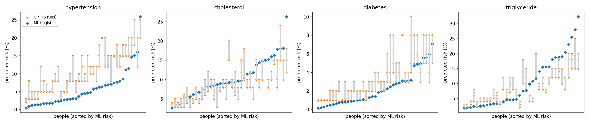
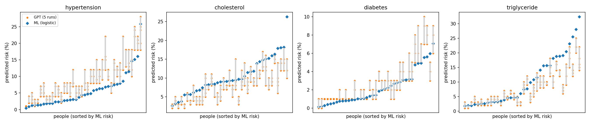

# 위험 예측 방식 비교실험 결과 (2026-10-13)

- 설계: `docs/superpowers/specs/2026-10-12-risk-model-redesign-design.md` 11절
- 원본 수치: `compare-metrics.json`(2절), `compare-llm-gpt-5.6-luna-metrics.json`(3절)
- 실행 코드 `training/compare.py`는 결과를 만든 뒤 삭제했다(a4ceede). 마지막 버전은 `git show 01d8474:training/compare.py`로 볼 수 있다.

## 0. 요약

계획 발표에서 받은 두 질문에 대한 답이다.

**① "표나 수식으로 보면 되는데 왜 학습 모델이 필요한가"**
- 25–44세 전원(약 2,900명) 기준으로 배포 로지스틱(②)의 AUROC가 체크리스트(①)보다 0.03–0.12 높다. 4개 질환 모두 차이의 95% 신뢰구간이 0을 넘는다.
- ②의 '보통 이상' 판정과 특이도를 비슷하게 맞추면 민감도 차이가 크다(②의 특이도는 66–77%다).

  | 질환 | ① 민감도 (특이도) | ② 민감도 (특이도) |
  |---|---|---|
  | 고중성지방 | 34% (84%) | 79% (66%) |
  | 고콜레스테롤 | 37% (84%) | 64% (66%) |
  | 고혈압 | 66% (75%) | 74% (72%) |

  ①은 점수가 정수라 동점이 많아서, 특이도를 정확히 맞추지 못하고 ②보다 높게 잡혔다. 그만큼 ①의 민감도가 낮게 나온 면이 있다.
- 체크리스트는 확률을 낼 수 없다. ②는 평균 예측이 실제 유병률과 거의 같다(예: 고혈압 9.2% vs 8.8%).
- 더 복잡한 모델(XGBoost)은 로지스틱과 같거나 약간 낮다. 단순한 모델로 충분하다.

**② "ChatGPT에 물어보는 것보다 무엇이 나은가"**
- **판별력(AUROC)으로는 이기지 못한다.** 무작위 500명 기준 GPT(`gpt-5.6-luna`)와 ②의 AUROC 차이는 4개 질환 모두 통계적으로 유의하지 않다. 당뇨는 GPT가 오히려 높았다(+0.044, 95% CI 0.000–0.106).
- **차이는 재현성이다.** 같은 사람에게 같은 입력을 5번 넣으면 GPT는 매번 다른 확률을 낸다. 앱의 등급 기준값으로 나누면 등급이 한 번이라도 바뀌는 사람이 질환별로 12.5–32.5%다. 더 큰 모델(`gpt-5.6-terra`)도 마찬가지다. ML은 같은 입력에 항상 같은 값을 낸다.
- 그래서 "숫자는 ML이 결정적으로 계산하고, LLM은 기여 요인을 받아 설명만 한다"는 구조가 맞다.
- **발표에서 하지 말아야 할 주장:** "ML이 GPT보다 정확하다." 이 데이터는 그 주장을 뒷받침하지 않는다.

## 1. 실험 설정

| 항목 | 내용 |
|---|---|
| 데이터 | 국민건강영양조사 2022–2024, 체성분검사(BIA) 측정자 |
| 학습 / 평가 | 19–59세로 학습, 25–44세에서 평가. 바깥 5-fold 교차검증 예측(배포 모델 평가와 같은 분할) |
| 라벨 | 고혈압 `HE_HP==4`, 당뇨 `HE_DM_HbA1c==3`, 고콜레스테롤 `HE_HCHOL==1`, 고중성지방 `HE_HTG==1`(치료 중인 환자 포함) |
| 입력 | 나이, 성별, BMI, 체지방률, 가족력 3개(고혈압·당뇨·고지혈증) |
| 지표 | AUROC(부트스트랩 95% CI), ②와의 AUROC 차이(짝지은 부트스트랩), AUPRC, Brier, 평균 예측, 같은 특이도에서의 민감도 |

**비교 모델**

| | 모델 | 내용 |
|---|---|---|
| ⓪ | 나이+성별 로지스틱 | 기준선 |
| ① | 체크리스트 점수(0–4점) | BMI 25 이상, 체지방률 남 25%·여 30% 이상, 해당 질환 가족력, 40세 이상을 각 1점으로 센다 |
| ② | 배포 로지스틱 | 앱에서 쓰는 모델. 고콜레스테롤만 나이 스플라인 |
| ③ | XGBoost | 같은 입력 |
| ④ | GPT 제로샷 | Codex CLI(ChatGPT 계정)로 같은 입력을 문장으로 주고, 질환 정의와 함께 0–100 확률을 JSON으로 받는다. reasoning low, 사람당 독립 호출 |

**같은 특이도에서의 민감도**: ②의 '보통 이상' 판정 특이도를 기준으로 삼는다. 다른 모델은 그 특이도 이상이 되는 가장 낮은 기준값을 쓴다. ①과 ④처럼 정수 점수는 동점 때문에 실제 특이도가 목표보다 높게 잡힐 수 있어서, 실제 특이도를 함께 적었다.

**GPT 표본**: Codex 사용량 한도 때문에 줄였다. luna는 20회 호출에 5시간 한도의 4%, terra는 7%를 썼다.
- 판별력 비교(3절): 25–44세에서 무작위로 뽑은 500명(seed 42), luna로 사람당 1회
- 반복 편차(4절): 그 500명 중 무작위 40명, 모델마다 사람당 5회
- 호출 실패: luna 660건, terra 198건 모두 0건

## 2. 규칙표·ML 비교 (25–44세 전원)

### 2.1 AUROC (95% CI)

| 질환 | n / 양성 | ⓪ 나이+성별 | ① 체크리스트 | ② 배포 로지스틱 | ③ XGBoost |
|---|---|---|---|---|---|
| 고혈압 | 2899 / 256 | 0.722 (0.690–0.755) | 0.753 (0.723–0.784) | **0.809** (0.780–0.836) | 0.792 (0.762–0.821) |
| 고콜레스테롤 | 2817 / 355 | 0.617 (0.587–0.646) | 0.668 (0.641–0.697) | **0.698** (0.672–0.726) | 0.685 (0.657–0.714) |
| 당뇨 | 2811 / 101 | 0.652 (0.595–0.706) | 0.791 (0.748–0.828) | **0.833** (0.790–0.873) | 0.830 (0.789–0.866) |
| 고중성지방 | 2522 / 300 | 0.730 (0.698–0.761) | 0.672 (0.644–0.702) | **0.792** (0.767–0.816) | 0.789 (0.762–0.814) |

### 2.2 ② 대비 AUROC 차이 (95% CI)

| 질환 | ⓪ 나이+성별 | ① 체크리스트 | ③ XGBoost |
|---|---|---|---|
| 고혈압 | −0.086 (−0.114 – −0.058) | −0.056 (−0.076 – −0.035) | −0.017 (−0.027 – −0.007) |
| 고콜레스테롤 | −0.082 (−0.108 – −0.057) | −0.030 (−0.047 – −0.014) | −0.013 (−0.029 – 0.001) |
| 당뇨 | −0.181 (−0.235 – −0.131) | −0.042 (−0.073 – −0.014) | −0.003 (−0.022 – 0.016) |
| 고중성지방 | −0.062 (−0.085 – −0.041) | −0.120 (−0.148 – −0.091) | −0.004 (−0.016 – 0.007) |

### 2.3 보정과 민감도

평균 예측은 실제 유병률과 비교한다. 민감도는 같은 특이도에서의 값이고, 괄호 안은 실제 특이도다. ①은 확률이 아니라서 평균 예측과 Brier가 없다.

| 질환 (실제 유병률) | 모델 | AUPRC | Brier | 평균 예측 | 민감도 (실제 특이도) |
|---|---|---|---|---|---|
| 고혈압 (8.8%) | ⓪ | 0.192 | 0.0762 | 9.2% | 59.8% (72.4%) |
| | ① | 0.215 | – | – | 65.6% (74.7%) |
| | ② | 0.305 | 0.0702 | 9.2% | 73.8% (72.4%) |
| | ③ | 0.285 | 0.0713 | 8.8% | 71.1% (72.4%) |
| 고콜레스테롤 (12.6%) | ⓪ | 0.185 | 0.1082 | 12.7% | 50.1% (66.0%) |
| | ① | 0.201 | – | – | 36.9% (84.4%) |
| | ② | 0.249 | 0.1037 | 12.7% | 63.9% (65.9%) |
| | ③ | 0.247 | 0.1043 | 12.6% | 60.6% (65.9%) |
| 당뇨 (3.6%) | ⓪ | 0.074 | 0.0342 | 3.7% | 46.5% (77.5%) |
| | ① | 0.105 | – | – | 67.3% (79.4%) |
| | ② | 0.197 | 0.0315 | 3.8% | 72.3% (77.3%) |
| | ③ | 0.180 | 0.0318 | 3.4% | 76.2% (77.3%) |
| 고중성지방 (11.9%) | ⓪ | 0.246 | 0.0973 | 10.7% | 73.0% (66.1%) |
| | ① | 0.187 | – | – | 34.0% (84.0%) |
| | ② | 0.293 | 0.0932 | 10.9% | 79.0% (65.9%) |
| | ③ | 0.314 | 0.0917 | 11.8% | 78.0% (65.9%) |

### 2.4 연령 하위군 AUROC

| 질환 | 구간 | n / 양성 | ⓪ | ① | ② | ③ |
|---|---|---|---|---|---|---|
| 고혈압 | 25–34 | 1067 / 44 | 0.730 | 0.718 | 0.784 (0.693–0.859) | 0.757 |
| | 35–44 | 1832 / 212 | 0.678 | 0.731 | 0.786 (0.755–0.817) | 0.770 |
| 고콜레스테롤 | 25–34 | 1041 / 88 | 0.585 | 0.640 | 0.683 (0.629–0.742) | 0.661 |
| | 35–44 | 1776 / 267 | 0.584 | 0.656 | 0.690 (0.657–0.724) | 0.675 |
| 당뇨 | 25–34 | 1037 / 20 | 0.562 | 0.803 | 0.857 (0.752–0.944) | 0.837 |
| | 35–44 | 1774 / 81 | 0.627 | 0.767 | 0.805 (0.757–0.849) | 0.809 |
| 고중성지방 | 25–34 | 923 / 94 | 0.701 | 0.686 | 0.765 (0.722–0.809) | 0.768 |
| | 35–44 | 1599 / 206 | 0.748 | 0.663 | 0.803 (0.773–0.832) | 0.795 |

### 2.5 해석

- ②는 4개 질환 모두 ⓪과 ①보다 판별력이 높다.
- 당뇨에서는 체크리스트가 꽤 가깝다(0.791 vs 0.833). 차이는 유의하지만 크지 않다.
- 고중성지방에서는 체크리스트(0.672)가 나이+성별(0.730)보다도 낮다. 체크리스트는 성별을 체지방률 기준에만 쓰는데, 고중성지방은 남녀 차이가 크기 때문으로 보인다.
- ②의 수치는 배포 모델 평가 보고서(`eval-2026-10-12.md`)와 소수점 넷째 자리까지 같다.

## 3. GPT 판별력 비교 (무작위 500명, `gpt-5.6-luna`)

모든 모델이 같은 사람을 평가했다. 질환별 n이 500보다 작은 것은 그 질환의 라벨이 없는 사람(예: 중성지방은 12시간 공복자만)을 뺐기 때문이다. 표본이 작아서 신뢰구간이 넓다. 특히 당뇨는 양성이 16명뿐이다.

### 3.1 AUROC (95% CI)

| 질환 | n / 양성 | ⓪ 나이+성별 | ① 체크리스트 | ② 배포 로지스틱 | ③ XGBoost | ④ GPT |
|---|---|---|---|---|---|---|
| 고혈압 | 500 / 33 | 0.738 (0.650–0.821) | 0.782 (0.686–0.867) | 0.816 (0.736–0.883) | 0.797 (0.712–0.867) | 0.791 (0.702–0.868) |
| 고콜레스테롤 | 485 / 55 | 0.632 (0.553–0.707) | 0.708 (0.638–0.779) | 0.702 (0.634–0.765) | 0.689 (0.611–0.758) | 0.717 (0.649–0.783) |
| 당뇨 | 482 / 16 | 0.610 (0.460–0.759) | 0.771 (0.636–0.867) | 0.759 (0.614–0.872) | 0.753 (0.587–0.887) | 0.803 (0.665–0.907) |
| 고중성지방 | 427 / 58 | 0.755 (0.685–0.824) | 0.697 (0.629–0.763) | 0.791 (0.723–0.850) | 0.794 (0.735–0.851) | 0.752 (0.689–0.811) |

### 3.2 GPT와 ② 비교

| 질환 (실제 유병률) | GPT − ② AUROC (95% CI) | Brier ② / GPT | 평균 예측 ② / GPT | 민감도 ② / GPT (실제 특이도) |
|---|---|---|---|---|
| 고혈압 (6.6%) | −0.024 (−0.052 – 0.004) | 0.0557 / 0.0601 | 9.0% / 12.8% | 72.7% (73.0%) / 69.7% (77.7%) |
| 고콜레스테롤 (11.3%) | +0.015 (−0.022 – 0.052) | 0.0960 / 0.0948 | 12.4% / 9.9% | 63.6% (66.3%) / 60.0% (69.1%) |
| 당뇨 (3.3%) | +0.044 (0.000 – 0.106) | 0.0315 / 0.0306 | 3.5% / 4.3% | 50.0% (80.7%) / 75.0% (80.9%) |
| 고중성지방 (13.6%) | −0.039 (−0.081 – 0.003) | 0.1030 / 0.1095 | 10.7% / 9.6% | 79.3% (68.6%) / 62.1% (71.3%) |

### 3.3 해석

- GPT의 판별력은 ②와 통계적으로 구별되지 않는다. 고혈압·고중성지방은 GPT가 낮고, 고콜레스테롤·당뇨는 높았다. 모두 신뢰구간이 0을 포함하거나 걸친다.
- 보정도 크게 틀어지지 않았다. 다만 고혈압은 GPT가 과대추정했다(평균 12.8% vs 실제 6.6%).
- 이 500명에서 ⓪–③의 AUROC는 2절(전원)과 조금씩 다르다. 표본이 작아서 생긴 변동이다. ⓪–③의 판단은 2절 수치를 기준으로 한다.

## 4. GPT 반복 응답 편차 (40명 × 5회)

같은 40명에게 같은 입력을 5회씩 넣었다. **앱 등급 변경**은 5회 응답을 앱의 등급 기준값(배포 모델의 보통·높음)으로 나눴을 때 등급이 한 번이라도 바뀐 사람의 비율이다. ML(②)은 결정적이라 모든 지표가 0이다.

앱 등급 기준값(보통 / 높음): 고혈압 10.8% / 26.2%, 당뇨 4.3% / 12.1%, 고콜레스테롤 13.5% / 26.4%, 고중성지방 11.7% / 28.6%

| 질환 | 모델 | 평균 예측 | 표준편차 중앙값 / 90% (%p) | 범위 중앙값 / 최대 (%p) | 앱 등급 변경 |
|---|---|---|---|---|---|
| 고혈압 | luna | 10.8% | 1.6 / 2.9 | 3.0 / 8.0 | 22.5% |
| | terra | 8.8% | 1.6 / 2.9 | 4.0 / 10.0 | **32.5%** |
| 고콜레스테롤 | luna | 8.8% | 1.3 / 2.8 | 3.0 / 9.0 | 17.5% |
| | terra | 7.8% | 1.3 / 2.6 | 3.0 / 8.0 | 22.5% |
| 당뇨 | luna | 3.3% | 0.5 / 1.6 | 1.0 / 6.0 | 20.0% |
| | terra | 2.8% | 0.5 / 1.2 | 1.0 / 4.0 | 12.5% |
| 고중성지방 | luna | 8.4% | 1.3 / 2.7 | 3.0 / 10.0 | 22.5% |
| | terra | 7.5% | 1.0 / 2.2 | 2.0 / 8.0 | 15.0% |





그림 읽는 법: x축은 40명을 ② 예측값 순서로 놓은 것이다. 주황 점은 GPT 5회 응답, 회색 세로선은 그 범위, 파란 마름모는 ② 예측값이다.

### 4.1 해석

- 두 모델 모두 같은 입력에 대해 응답이 흔들린다. 등급이 바뀌는 사람이 질환별로 12.5–32.5%다.
- 더 큰 모델(terra)이 일관되게 안정적이지 않다. 고혈압·고콜레스테롤은 terra가 더 흔들렸고, 당뇨·고중성지방은 덜 흔들렸다. 모델을 키워도 문제가 사라지지 않는다.
- terra는 luna보다 전반적으로 0.5–2%p 낮게 예측한다. 40명에는 판별력 평가가 없어서 어느 쪽이 더 정확한지는 알 수 없다.
- luna의 판정 변경을 ④ 자신의 '같은 특이도' 기준값으로 계산하면 20.0–25.0%다(고혈압 20.0, 고콜레스테롤 25.0, 당뇨 22.5, 고중성지방 22.5). 위 표의 앱 기준값으로 계산한 값과 조금 다르다. 두 모델을 나란히 보여줄 때는 앱 기준값으로 계산한 위 표를 쓴다.

## 5. 한계

- **GPT 표본이 작다.** 판별력은 500명(당뇨 양성 16명), 편차는 40명이다. Codex 사용량 한도 때문이다.
- **Codex는 순수 채팅이 아니다.** Codex 에이전트 지시문은 짧은 지시문으로 바꿨지만 도구 정의 등이 붙는다. 일반 ChatGPT 대화와 조건이 완전히 같지 않다.
- **프롬프트를 1개로 고정했다.** 이 실험은 LLM이 낼 수 있는 최고 성능이 아니라, 같은 정보로 일반적인 질문을 했을 때를 측정한다.
- **데이터 외부 전송.** KNHANES 참가자의 입력 7개(ID·조사연도·라벨 제외)를 외부 LLM으로 보냈다. 이용약관 판단은 사용자가 했다(2026-10-13). 응답 캐시는 분석 후 삭제했다.
- **단면 자료다.** 미래 발병 위험이 아니라 '현재 유병일 확률'을 비교했다.

## 부록: GPT 프롬프트 원문 (예시 입력)

```
당신은 의료 위험도를 추정하는 도우미입니다.
아래 사람의 정보만으로, 이 사람이 현재 각 질환에 해당할 확률을 0-100 정수로 답하세요.
정보가 제한적이어도 반드시 최선의 추정치를 숫자로 답하세요.

[정보]
나이 34세, 남성, BMI 26.1, 체지방률 27.4%
고혈압 가족력 있음, 당뇨 가족력 없음, 고지혈증 가족력 없음

[질환 정의]
- hypertension(고혈압): 측정 혈압 140/90mmHg 이상 또는 혈압약 복용
- diabetes(당뇨): 공복혈당 126mg/dL 이상, 당화혈색소 6.5% 이상, 의사 진단, 또는 약·인슐린 치료
- cholesterol(고콜레스테롤): 총콜레스테롤 240mg/dL 이상 또는 약 복용
- triglyceride(고중성지방): 12시간 이상 공복 시 중성지방 200mg/dL 이상
```

Codex 호출 설정: `codex exec --ignore-user-config -m <모델> -c model_reasoning_effort=low -c model_instructions_file=<"You are a helpful assistant. Answer the user's question directly."> --output-schema <0–100 정수 4개>`. stdin을 닫고 빈 폴더에서 실행했다.
